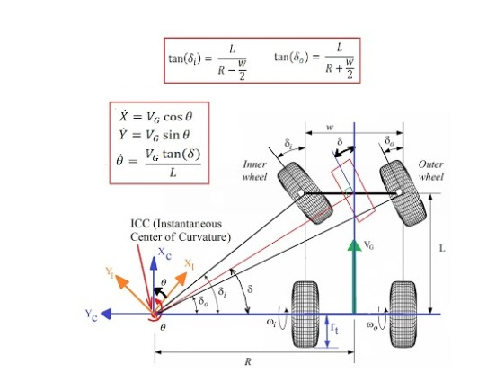
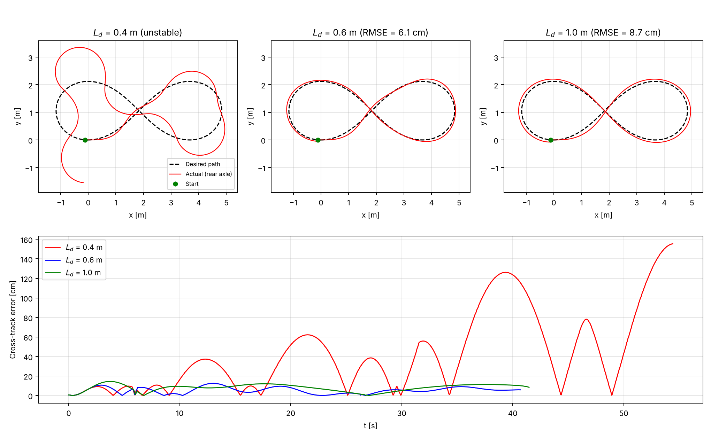

# Ackermann Mobile Robot

Ackermann-steered mobile robot modeled in Autodesk Fusion 360 and exported to Xacro/URDF. The robot is simulated in Gazebo Harmonic and controlled by a ROS 2 node implementing the Pure Pursuit algorithm, which follows a figure-eight trajectory (Bernoulli lemniscate).

**Team Members:** _Steven Yari_, _Cristhian Ortiz_, _Alexa Marin_  
**Course:** Mobile and Articulated Robots, ESPOL

---

## 1. Requirements

| Component | Version |
|---|---|
| Operating System | Ubuntu 24.04 LTS |
| ROS 2 | **Jazzy Jalisco** (desktop) |
| Simulator | **Gazebo Harmonic** (`gz sim`, version 8.x), installed via `ros-jazzy-ros-gz` |
| Python | 3.12 (Ubuntu 24.04 default version) |

> ROS 2 Humble is not supported. The Ackermann plugin (`gz-sim-ackermann-steering-system`) and launch files require Gazebo Harmonic.

### Dependencies

```bash
sudo apt update
sudo apt install ros-jazzy-ros-gz ros-jazzy-xacro ros-jazzy-robot-state-publisher \
                 python3-colcon-common-extensions python3-rosdep liburdfdom-tools
```

Optional, only to generate the result plots (`tools/plot_results.py`):

```bash
sudo apt install python3-pandas python3-matplotlib
```

---

## 2. Build

```bash
git clone https://github.com/StevenYari/ws_Project_group14.git
cd ws_Project_group14

source /opt/ros/jazzy/setup.bash
rosdep install --from-paths src --ignore-src -r -y
colcon build --symlink-install
source install/setup.bash
```

If `rosdep` reports that it is not initialized, run `sudo rosdep init` and `rosdep update` once, then repeat the `rosdep install` command.

The build should finish with:

`Summary: 2 packages finished`

Optional model validation:

```bash
xacro src/ackermann_description/urdf/ackermann_bot.xacro > /tmp/r.urdf
check_urdf /tmp/r.urdf      # Should display "Successfully Parsed XML"
```

---

## 3. Running the Simulation

Run the following command in **a single terminal**, after sourcing both ROS 2 and the workspace:

```bash
ros2 launch ackermann_description full_sim.launch.py
```

What happens:

1. Gazebo starts with an empty world and the robot appears (red and black).
2. The ROS ↔ Gazebo bridge is activated (`/cmd_vel`, `/odom`, `/tf`, `/clock`, `/joint_states`).
3. After 10 seconds, the controller starts and the robot follows the figure-eight trajectory (approximately 40 seconds of simulated time).
4. At the end, the robot stops and the terminal prints a summary similar to:

   `FIN. Duracion 40.7 s | RMSE cte = 0.064 m | cte max = 0.128 m | CSV: ...`

Gazebo remains open until you close it using `Ctrl+C`.

If your computer is slow or you are running the simulation inside a virtual machine, real execution time will be longer than simulated time. The trajectory may take approximately one minute to complete.

### Launch Arguments

| Argument | Default Value | Description |
|---|---|---|
| `path_type` | `lemniscate` | `lemniscate` (figure-eight), `circle`, or `oval` |
| `lookahead` | `0.6` | Pure Pursuit lookahead distance L_d [m] |
| `speed` | `0.4` | Constant linear velocity [m/s] |
| `size` | `3.0` | For the lemniscate: parameter `a` [m]; total length is `2a` and the minimum curvature radius is `a/3` |
| `radius` | `1.5` | Radius of the circle or oval curves [m] |
| `straight` | `2.0` | Length of the oval straight sections [m] |
| `delay` | `10.0` | Delay before the controller starts [s] |

Examples:

```bash
ros2 launch ackermann_description full_sim.launch.py lookahead:=0.8
ros2 launch ackermann_description full_sim.launch.py path_type:=circle radius:=1.5
ros2 launch ackermann_description full_sim.launch.py speed:=0.3 size:=3.5
```

The robot has a minimum turning radius of approximately 0.83 m. Therefore, any trajectory must have a curvature radius greater than this value. The node displays a `WARN` message if the requested trajectory exceeds the robot's steering capabilities.

Note: use `lemniscate` (not `infinity`) as `path_type` in the launch file. ROS parses the word `infinity` as a numeric value.

### Running the Simulation and Controller Separately

```bash
# Terminal 1: Simulation (Gazebo + robot + bridge)
ros2 launch ackermann_description sim.launch.py

# Terminal 2: Controller
ros2 run ackermann_control pure_pursuit --ros-args -p use_sim_time:=true -p lookahead:=0.6
```

### Manual Robot Control (Quick Test)

```bash
ros2 topic pub -r 10 /cmd_vel geometry_msgs/msg/Twist "{linear: {x: 0.3}, angular: {z: 0.3}}"
ros2 topic pub --once /cmd_vel geometry_msgs/msg/Twist "{}"     # Stop
```

---

## 4. Repository Structure

```text
ws_Project_group14/
├── README.md
├── docs/                         # Results figures
├── tools/plot_results.py         # Plots and metrics generated from CSV files
└── src/
    ├── ackermann_description/    # Robot model and simulation
    │   ├── urdf/ackermann_bot.xacro
    │   ├── meshes/*.stl          # Parts exported from Fusion 360
    │   └── launch/
    │       ├── sim.launch.py         # Gazebo + robot + bridge
    │       └── full_sim.launch.py    # Simulation + controller (single command)
    └── ackermann_control/        # Robot controller
        └── ackermann_control/pure_pursuit.py   # Trajectory generation + Pure Pursuit
```

---

## 5. Robot and Model

Values obtained from the URDF exported from Fusion 360 and confirmed against the CAD model.

| Parameter | Value |
|---|---|
| Wheelbase L | 0.24 m |
| Track width W (wheel to wheel) | 0.14 m |
| Distance between steering pivots (kingpins) | 0.06 m |
| Wheel radius | 0.04 m |
| Wheel width | 0.02 m |
| Maximum steering angle (plugin / mechanical limit) | 0.28 rad (16°) / 0.314 rad (18°) |
| Minimum turning radius | ≈ 0.83 m |
| Total mass | ≈ 13.7 kg |
| Drive / Steering | Rear wheels / Front wheels |

### Model Notes

- The CAD model originally had the front of the robot facing the −X direction. This is corrected in Xacro using a root link called `base_footprint`, rotated 180°, with adjusted joint axes.
- Collision geometry: the four wheels use cylinders; the chassis and the steering pivots keep their STL meshes; the LiDAR link has no collision. Wheel friction is set to μ = 1.0 (chassis: 0.2).
- The plugin limit of 0.28 rad is the central (virtual) steering angle. It is chosen so that the inner front wheel, which turns more, stays below the 0.314 rad joint limit.
- The LiDAR link (`lidar_1`) is modeled, but the sensor is disabled. This project does not implement SLAM.
- The Gazebo plugin is `gz-sim-ackermann-steering-system`. It receives `/cmd_vel` and publishes `/odom` and `/tf`, and it computes the individual steering angle of each front wheel.

### Kinematic Model (Bicycle Model, Rear Axle Reference)



*Geometry of the Ackermann steering: Instantaneous Center of Curvature (ICC), inner and outer steering angles, and rear axle reference.*

Notation: `(X, Y)` is the rear axle center in the global frame, `θ` the yaw angle, `V_G` the linear velocity of the rear axle, `δ` the virtual central steering angle, `L` the wheelbase and `R` the turning radius of the rear axle.

Vehicle motion (non-holonomic constraints):

```text
Ẋ = V_G·cosθ      Ẏ = V_G·sinθ      θ̇ = (V_G / L)·tanδ
R = L / tanδ       R_min = L / tan δ_max
```

Ackermann condition: all wheel axes meet at the ICC, so the inner and outer front wheels follow different angles:

```text
tan δ_i = L / (R − W/2)        tan δ_o = L / (R + W/2)
```

Substituting `R = L / tanδ`:

```text
δ_i = arctan( 2L·tanδ / (2L − W·tanδ) )
δ_o = arctan( 2L·tanδ / (2L + W·tanδ) )
```

Here `W` is the distance between the steering pivots (kingpins), 0.06 m, the same value configured as `kingpin_width` in the Gazebo plugin. The rear wheels also travel different distances: `v_i = ω(R − W_track/2)` and `v_o = ω(R + W_track/2)`, with `W_track` = 0.14 m (`wheel_separation` in the plugin).

Values for this robot at the steering limit (`δ_max = 0.28 rad`, `L = 0.24 m`):

| Quantity | Value |
|---|---|
| Minimum turning radius `R_min` | 0.83 m |
| Maximum curvature `tan δ_max / L` | 1.20 m⁻¹ |
| Inner front wheel `δ_i` | 0.290 rad (16.6°) |
| Outer front wheel `δ_o` | 0.271 rad (15.5°) |

The inner wheel stays below the 0.314 rad (18°) limit of the steering joints.

---

## 6. Controller: Pure Pursuit

The Pure Pursuit controller follows these steps:

1. Reads the robot pose from `/odom` and transforms it to the rear axle reference point (0.12 m behind the model origin).
2. Finds the closest point on the trajectory and then determines the target point at a lookahead distance of **L_d**.
3. Calculates the curvature using **κ = 2·sin(α) / L_d**, where α is the angle between the robot's heading and the target point. The curvature is clipped to the robot's maximum steering curvature (tan δ_max / L ≈ 1.20 m⁻¹).
4. Publishes `v` and `ω = v·κ` to `/cmd_vel`. The Gazebo plugin converts these commands into the steering angles of each wheel.
5. When the robot reaches the end of the trajectory, it publishes zero velocity and saves the results.

Default trajectory: Bernoulli lemniscate with `a = 3 m`:

```text
x(t) = a·cos t / (1 + sin² t)
y(t) = a·sin t·cos t / (1 + sin² t)
```

It is 6 m long and 2.1 m wide, with 15.7 m of total path length and a minimum curvature radius of 1.0 m (maximum curvature 1.0 m⁻¹, below the 1.20 m⁻¹ limit of the robot). The path is generated relative to the starting pose of the robot.

---

## 7. Results

Trajectory: figure-eight, `a = 3 m`, velocity = 0.4 m/s. Cross-track error is measured from the rear axle to the closest trajectory segment.

| L_d [m] | Completed | RMSE [cm] | Max Error [cm] | Steering Saturation |
|---|---|---|---|---|
| 0.4 | No (unstable)* | 58.3 | 155.5 | 80% |
| 0.6 | Yes | **6.1** | 12.4 | 3.6% |
| 1.0 | Yes | 8.7 | 14.4 | 1.8% |

\* The run with L_d = 0.4 m was stopped manually after the robot lost the trajectory (54 s).

Steering saturation is the percentage of samples in which the curvature command is clipped at the steering limit (δ = 16°).

### Analysis

- With L_d = 0.4 m, the robot oscillates and loses track of the trajectory.
- With L_d = 0.6 m, the controller achieves the highest tracking accuracy. The largest error (≈12 cm) occurs inside the lobes, not at the central crossing.
- With L_d = 1.0 m, the motion is smoother, but the robot takes wider turns (it stays on the outside of the curves).

The RMSE value printed by the node (0.064 m with L_d = 0.6 m) is slightly higher than the value in the table because it measures the distance to the closest trajectory point rather than to the closest trajectory segment.



### Data Logging

Each simulation run saves its results in `~/ackermann_results/`:

- `run_*.csv`: `t, x, y, yaw, v_cmd, w_cmd, delta_est, target_x, target_y, cte`
- `path_*.csv`: Desired trajectory (`x, y`)

To generate the plots and metrics of the latest run:

```bash
python3 tools/plot_results.py
```

The figures are saved in `~/ackermann_results/figures/`. This requires `python3-pandas` and `python3-matplotlib`.

---

## 8. Troubleshooting

| Problem | Solution |
|---|---|
| `Package 'ackermann_description' not found` | Run `source install/setup.bash` in that terminal. |
| Gazebo closes with `Segmentation fault` in `VisualizeLidar` and messages about `OmniTeleop` | Corrupted GUI configuration: `mv ~/.gz/sim/8/gui.config ~/.gz/sim/8/gui.config.bak` |
| The Gazebo window fails on Ubuntu with Wayland | Launch with `QT_QPA_PLATFORM=xcb ros2 launch ...` |
| Warnings `VMware: No 3D enabled` or `libEGL warning` | The system is a virtual machine without 3D acceleration: it works, but more slowly. |
| The controller starts before the robot appears | Increase the delay: `delay:=20`. |
| `path_type:=infinity` raises a parameter type error | Use `lemniscate` instead. |
| The robot does not move | Check `ros2 topic list` (`/cmd_vel`, `/odom`, `/tf`, `/clock`, `/joint_states`) and `ros2 topic echo /odom --once`. |
| A new simulation starts where the previous one ended | Stop the previous launch with `Ctrl+C` before starting another one. |

---

## 9. License

MIT License.
